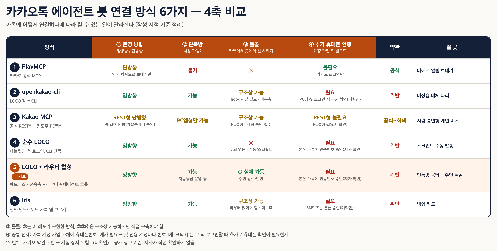

# kakao-agent-router

카카오톡 방에서 **주인이 AI 에이전트에게 일을 시키고(툴콜)**, **채팅 인터뷰로 봇에 새 기능을 추가**하는 최소 라우터.
Python 표준 라이브러리만 쓰는 파일 두 개(`router.py`, `transport.py`)로 이루어져 있다.

```
[카톡 방] ──(LOCO)── transport.py ── router.py ──┬─ /에이전트 할 일  → hermes -z  (또는 agent_cmd)
                                                 ├─ /기능추가        → 5문항 인터뷰 → 초안 → /승인 → 설치
                                                 └─ /<기능이름> 할 일 → 설치된 스킬/플러그인 실행
```

> ⚠️ **먼저 읽을 것.** 기본 전송층(`agent-kakaotalk`)은 카카오 공식 API가 아니라 LOCO 프로토콜을 쓰는 비공식 클라이언트다.
> **카카오 이용약관 위반이며 계정이 정지될 수 있다.** 반드시 봇 전용 계정을 쓰고, 본인 주계정으로 돌리지 말 것.

## 왜 만들었나

카카오톡에는 일반 단톡방에 봇을 붙이는 공식 API가 없다. 공식 경로(PlayMCP, 카카오 REST)는 "나와의 채팅" 발신까지만 되고,
양방향이 되는 비공식 경로는 메시지를 주고받는 **전송층**만 준다. 그 위에서 "누가 시켰을 때만 실행하나", "새 기능을 어떻게 안전하게 붙이나"는 각자 만들어야 한다.

이 레포는 저자가 실제 운영 중인 카톡 봇에서 그 **라우터 층만** 떼어내 일반화한 것이다. 업무 답변 로직·데이터는 들어 있지 않다.



표의 ⑤가 이 레포의 위치다. 표 원본은 [`docs/six-paths.html`](docs/six-paths.html). 작성 시점 기준 정리이며 "(미확인)"은 저자가 직접 확인하지 않은 항목이다.

## 무엇을 하나

| 명령 (주인만) | 동작 |
|---|---|
| `/에이전트 할 일` (`/agent`) | 에이전트를 원샷 호출하고 결과를 카톡으로 회신 |
| `/기능추가` | 5문항 인터뷰(이름·하는 일·트리거 예시·입력/도구·완료 기준) → 초안 생성 |
| `/승인 <id>` · `/거절 <id>` | 초안을 설치하거나 버림. **승인 전에는 아무것도 설치·실행되지 않음** |
| `/<기능이름> 할 일` | 설치된 기능 실행 |
| `/기능목록` · `/취소` | 설치 목록 / 진행 중인 인터뷰 취소 |

모든 메시지는 처리 경로를 `data/routes.jsonl`에 남긴다(`not_owner`, `agent`, `interview_done`, `approve` …). 봇이 왜 반응하지 않았는지 나중에 셀 수 있다.

## 두 가지 실행 방식

`config.json`의 `backend`로 고른다.

**1) `hermes` (기본)** — [Hermes Agent](https://github.com/NousResearch/hermes-agent) 사용자용.
- `/에이전트` → `hermes -z "<요청>"`
- 인터뷰 결과 → Hermes 스킬 `SKILL.md`로 생성되어 `skills_dir`(기본 `~/.hermes/skills/kakao-added/<이름>/`)에 설치
- `/<이름> 할 일` → `hermes -s <이름> -z "<요청>"` (스킬을 미리 로드한 원샷 호출)

**2) `python`** — Hermes가 없을 때.
- 인터뷰 결과 → `plugins/<이름>.py` 생성. 파일 안에 인터뷰 답이 `SPEC`으로 들어가고 `run(task, ctx)` 하나만 있다.
- `run()`을 직접 구현하거나, 그대로 두면 `agent_cmd`(예: `["claude", "-p"]`, `["codex", "exec"]`)에 SPEC과 요청을 붙여 넘긴다.
- `agent_cmd`가 없으면 `/에이전트`와 미구현 플러그인은 "설정이 필요하다"고만 답한다.

## 설치

필요한 것: Python 3.9+, Node.js, [agent-messenger](https://www.npmjs.com/package/agent-messenger)의 `agent-kakaotalk` CLI, 봇 전용 카톡 계정, (hermes 방식이면) Hermes.

```bash
npm install -g agent-messenger
agent-kakaotalk auth login          # 봇 전용 계정. 새 기기 등록 시 그 계정 폰의 카톡에서 인증번호 승인
agent-kakaotalk whoami              # 봇 user_id 확인
agent-kakaotalk chat list           # chat_id 확인

git clone <this repo> && cd kakao-agent-router
cp config.example.json config.json  # rooms / owner_chat_id / owner_user_id 채우기
python3 tests/test_router.py        # ALL OK 확인
python3 router.py --once            # 기준선만 잡고 종료 (과거 메시지는 실행하지 않음)
python3 router.py                   # 상시 실행 (launchd/systemd 등으로 띄우기 권장)
```

주인 `owner_user_id`는 주인이 봇 방에 보낸 메시지의 `author_id`다 (`agent-kakaotalk message list <chat_id>`).
Hermes 사용자는 [`hermes-skill/kakao-agent-router/SKILL.md`](hermes-skill/kakao-agent-router/SKILL.md)를 스킬 폴더에 넣으면 에이전트가 이 라우터를 운영·수정할 때 참고한다.

## 안전 설계 — 채팅으로 기능이 생긴다는 것의 위험

"카톡 한 줄로 봇에 기능이 생긴다"는 남에게 열리면 곧 **원격 명령 실행 통로**다. 그래서 기본값을 이렇게 잡았다.

1. **주인 = 주인 방 AND 주인 user_id.** 둘 다 맞아야 명령으로 본다. 주인 방에 다른 사람이 있어도, 주인이 다른 방에서 말해도 실행되지 않는다.
2. **승인 게이트.** 인터뷰는 초안만 만든다. 설치는 주인의 `/승인 <id>`(6자리 16진수)뿐이며, id 형식이 아니면 명령으로 인식하지 않는다(경로 조작 차단).
3. **덮어쓰기 금지.** 같은 이름의 기능이 있으면 인터뷰 단계와 승인 단계에서 두 번 막는다.
4. **과거 재생 금지.** 첫 실행은 기준선만 잡는다. 처리 전에 위치를 저장해 재시작해도 같은 명령을 두 번 실행하지 않는다.
5. **격리.** 플러그인 예외·에이전트 타임아웃은 카톡 오류 메시지로 끝나고 라우터는 계속 돈다. 회신은 3000자에서 자른다.

이 레포가 **막지 못하는 것**도 분명히 적는다.
- `hermes -z`는 도구 승인 프롬프트를 자동 통과한다. 주인 계정 자체가 탈취되면 그 계정 권한으로 무엇이든 실행될 수 있다.
- 인터뷰로 만든 스킬/플러그인의 **내용 검토는 사람 몫**이다. 승인 메시지에 초안 앞부분(1500자)을 보여주지만, 코드 실행 결과를 미리 검증해 주지는 않는다.
- 비공식 전송층은 카카오 쪽 변경으로 언제든 깨질 수 있다.

## 다른 전송층으로 바꾸기

`transport.py`의 클래스는 `my_user_id()`, `fetch(chat_id, since)`, `send(chat_id, text)` 세 메서드만 가진다.
같은 세 메서드를 가진 클래스를 만들어 `router.py`의 `main()`에서 바꿔 끼우면 Iris 같은 다른 경로로 옮길 수 있다.
테스트의 `FakeTransport`가 가장 짧은 예시다. 주인 이외의 메시지에 답하는 봇을 만들려면 `Router.handle_other()`를 채운다.

## 한계

- 폴링 방식이라 응답에 `poll_interval`(기본 20초)만큼 지연이 있다. 실시간 수신(listener)은 넣지 않았다.
- 인터뷰는 한 번에 하나만 진행된다. 진행 중에는 주인 메시지가 전부 답변으로 들어가므로 다른 명령은 `/취소` 뒤에 쓴다.
- 사진·파일 전송, 단톡방 Q&A 답변 로직, 사용량 상한은 들어 있지 않다.
- 인터뷰 질문 5개는 고정이다. 바꾸려면 `router.py`의 `QUESTIONS`를 고친다.

## 테스트

```bash
python3 tests/test_router.py
```
가짜 전송층·가짜 에이전트로 다음을 확인한다: 첫 실행 재생 금지, 남의 방/주인 방의 남/봇 자신 무시, 인터뷰 이름 검증·취소·중복 거부,
승인 전 미설치·남의 승인 거부, hermes 인자(`-s <이름> -z`), python 플러그인 실행·예외 격리, 거절 시 초안 삭제, 경로 조작 무시.

## 라이선스

MIT
